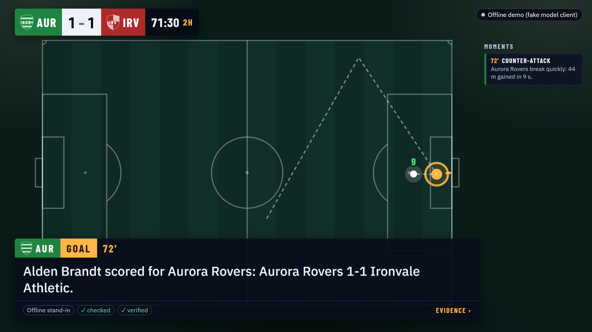
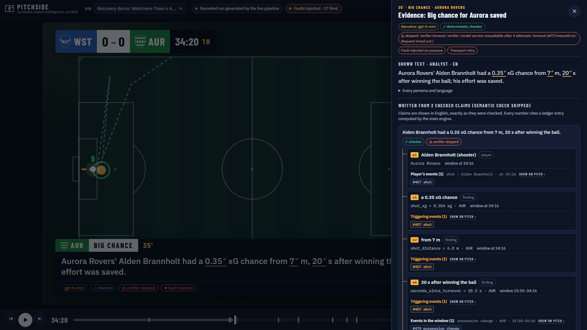
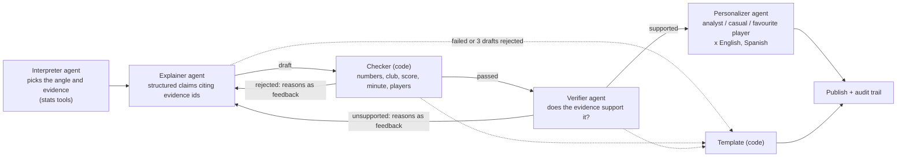

# Pitchside

**Synthetic football events in, match insights out: numbers checked by code, claims traced to their evidence.**

[](https://github.com/rahmanshah/pitchside-developer-hackathon/actions/workflows/ci.yml)

**[Live demo](https://green-cliff-068ccc50f.3.azurestaticapps.net)** · **[Demo video (1:53)](https://www.youtube.com/watch?v=VqwtphDpU5Q)**
· [Architecture](docs/ARCHITECTURE.md) · [Live evaluation](docs/LIVE_EVAL.md) · [Azure](docs/AZURE.md)
· [MCP server](docs/MCP.md) · [Overlay contract](docs/OVERLAY.md) · [Decision log](docs/DECISIONS.md)

Built for the **Inside the Game: Developer Hackathon**, challenge "The Synthetic Match Insights Engine for Premier
League Studio". Every club, player and match is invented and generated from a seed. No real match data, names or logos.

## What it does

| Stage | Pitchside |
|---|---|
| **Ingest** | A seeded generator streams typed events (pass, shot, tackle, pressure, possession change). `(seed, clubs, storyline)` fully determines a match, and an answer key lists the phases and goals that were planted. |
| **Interpret** | A deterministic stats engine (no LLM) keeps rolling and cumulative possession, field tilt, pressure, pass difficulty, shots and xG, momentum and a control-vs-chaos index, and emits typed findings (goal, big chance, momentum shift, pressure surge, siege, chaos spell, counter-attack), each with its evidence numbers and time window. |
| **Explain** | Four Microsoft Agent Framework agents (interpreter, explainer, verifier, personalizer) and a deterministic checker, in one graph workflow per moment, plus half-time and full-time recaps. |
| **Render** | A timed overlay contract (`overlay.json`) and a static web UI: broadcast view, analyst dashboard, evidence drawer. |
| **Personalize** | Analyst, casual fan and favourite-player views, in English and Spanish, written in one personalizer call per moment. Every text, in every language, is re-checked by the deterministic checker (not by the semantic verifier). |

**Numbers first, words second.** The stats engine computes every figure. Agents only write words around figures it
computed, citing each one by its evidence id. Narrative claims are shown only after the deterministic checker and the
semantic verifier both pass them. If the verifier is unavailable, claims are shown on the checker alone and flagged
"semantic check skipped". Persona texts, English and Spanish, are re-checked by the deterministic checker only, not by
the verifier. Headlines get only the checker's invented-detail test. If a model fails or every draft is rejected, a
template built from the same numbers is shown instead, labelled "Template".






*Captured from the published live runs by `uv run python scripts/capture_screenshots.py` at 1920 x 1080.*

## Try it in 2 minutes

### a) The live site, no setup

The site replays **recorded runs that the live pipeline generated** (gpt-5-mini on Microsoft Foundry, stats tools on
the cloud MCP server). The page itself calls no model, and every run is labelled "Recorded run generated by the live
pipeline". The cloud MCP server accepts only the author's IP address, so judges cannot re-run the cloud path. The
recordings and their Run info panel are the evidence.

| Open | What you see |
|---|---|
| [Comeback, 87' winner](https://green-cliff-068ccc50f.3.azurestaticapps.net/?run=comeback&view=broadcast&t=86:15&speed=4&autoplay=1&persona=casual&lang=en) | Plays from 86:15 at 4x. Aurora Rovers go 2-1 up, and the goal lower third shows its checked and verified chips. |
| [Siege, casual fan](https://green-cliff-068ccc50f.3.azurestaticapps.net/?run=siege&view=broadcast&t=36:40&persona=casual&lang=en) | The 37' opener for Harbourton City, told for a casual fan. Switch persona or language from the controls. |
| [Recovery demo, faults injected](https://green-cliff-068ccc50f.3.azurestaticapps.net/?run=faults-demo&view=broadcast&t=47:10&persona=analyst&lang=en&drawer=wst_aur_end_to_end_0004:goal:1) | The "Faults injected · 17 fired" chip. The drawer's audit trail shows a corrupted first draft rejected by the checker (`number_mismatch`) and the retry that passed. |

What to look for:

- **Evidence drawer** (`E`, or *Evidence ›* on any overlay): the shown text, the claims it was written from, each
  claim's ledger numbers with metric and window, the events behind them, and the audit trail (drafts, rejections,
  retries, fallbacks, model calls).
- **EN / ES** (`L`): the personalizer's own Spanish, from the same call as the English.
- **Run info** (`I`): model deployments, prompt versions, budget, and the stats tools used (`mcp`).
- **Faults chip**: only `faults-demo` has faults, injected on purpose to show recovery. The other two runs are clean.
- Other keys: `Space` play or pause, `N`/`B` next or previous moment, `2` analyst dashboard.

### b) Run it locally, offline

Needs [uv](https://docs.astral.sh/uv/). No Azure account, no credentials, no cost. Without a `.env` file everything
runs on a deterministic fake model client, and its output is labelled "Offline run (fake model client)".

```bash
uv sync
uv run pitchside serve --open      # the web UI with the same recorded runs, http://127.0.0.1:8000
uv run pitchside generate --seed 7 --storyline comeback              # matches/aur_irv_comeback_0007.jsonl + answer key
uv run pitchside findings matches/aur_irv_comeback_0007.jsonl        # key moments with their evidence numbers
uv run pitchside run --seed 7 --storyline comeback                   # whole pipeline, writes runs/bundles/<run>/
uv run pitchside run --seed 7 --storyline comeback --tools mcp       # same, stats tools served over MCP (in-process)
uv run pitchside run --seed 4 --storyline end_to_end --home wst --away aur --inject-faults demo   # recovery paths
uv run pitchside eval-agents --seeds 1-3 --inject-bad 0.3            # offline plumbing check, not model quality
uv run pytest                                                        # the test suite (a few minutes)
```

How many faults fire with `--inject-faults demo` varies by run: some faults repeat on every model call of their job, up
to a limit, and the number of calls depends on the model. 16 fired in an offline run of this command, 17 in the
published `faults-demo` recording.

Live mode needs `PITCHSIDE_LLM=foundry`, a Foundry project and `--live` on top, so a stray command never spends money
([LIVE_EVAL.md](docs/LIVE_EVAL.md)).

## Architecture

```
generator ──events──► stats engine ──findings──► director (code) ──one job per moment──► agent workflow
                          │                                                        │
                          └── read-only MCP server (12 tools, as_of_s bound) ◄─────┘ interpreter's stats tools
agent workflow ──► run bundle (events, stats, findings, narratives, audit, usage) ──► overlay.json ──► web UI
```

Each moment runs through its own Agent Framework graph workflow (`WorkflowBuilder`) with typed handoffs:



| Part | Kind | Job | If it fails |
|---|---|---|---|
| Interpreter | Agent | Picks the angle and the evidence; calls the stats tools (local functions or MCP) | Rule-based brief |
| Explainer | Agent | Writes structured claims; each cites evidence ids and lists every number it uses | After 3 rejected drafts or an outage: template narrative with its reason |
| Checker | Code | Rejects a number that does not match its evidence, a figure given to the wrong club, a score the match never had, a minute outside the window, a player the evidence does not include, invented details (woodwork, body parts, records) | It is the gate; nothing bypasses it |
| Verifier | Agent | Judges overclaiming and unsupported causes; reasons go back to the explainer | Claims shown on the checker alone, flagged "semantic check skipped" |
| Personalizer / translator | Agent | Analyst, casual and favourite-player texts in every language, one call; each text re-checked by the deterministic checker only (no semantic verifier) | Template text for that persona |
| Director | Code | Picks which findings get model calls (no coordinator agent: routing has one correct answer) | — |
| Evidence ledger | Shared state | Every number a model may use has an id (`e*` finding, `c*` tool result, `p*` player) | — |
| Audit trail | Record | Prompt version and digest, claims, verdicts with reason codes, feedback, retries, fallbacks, one usage row per call | — |
| Run bundle | Files | Plain JSON per run ([schema](docs/run_bundle.schema.json)); the site replays these | — |
| MCP server | Service | The stats engine as 12 read-only tools; every stats tool requires `as_of_s`, and the host overwrites it so a model cannot see later play | — |

Reasons for each choice, and what was rejected: [docs/DECISIONS.md](docs/DECISIONS.md) (13-15 for the agents and MCP).

## Microsoft technology: what is deployed, what is not

| Technology | Status | Used for |
|---|---|---|
| Microsoft Foundry, gpt-5-mini (Global Standard, Sweden Central) | Deployed | Every agent role, through the Responses API, reasoning effort `low`. GPT-6 Luna is the target, but the trial subscription has no Luna quota ([decision 19](docs/DECISIONS.md)) |
| Microsoft Agent Framework (agent-framework-core 1.22.0, agent-framework-openai 1.17.0) | Used | Four `Agent`s, a `WorkflowBuilder` graph per moment, function tools, MCP client tools, chat and function middleware (budget, concurrency, deadline, retry, usage log) |
| Microsoft Entra ID (`DefaultAzureCredential`, azure-identity 1.26.0) and Azure AI Projects SDK 2.9.0 | Used | Signing in to the Foundry project for the live recordings; no API keys |
| Azure Container Apps (Consumption) | Deployed | The MCP stats server: 0.25 vCPU / 0.5 GiB, scales to zero (0-1 replicas), IP allow-list, in-app rate limit (120 requests per minute per client, 300 overall) |
| Azure Static Web Apps (Free, eastus2) | Deployed | The web UI and the recorded runs |
| Log Analytics (Azure Monitor) | Deployed | Container logs, one JSON line per MCP request (1 GB/day cap) |
| Cost Management budget | Deployed | 25 EUR a month on the resource group; e-mail at 50% and 100% of actual cost and 100% of forecast |
| Bicep, GitHub Actions, GitHub Container Registry | Used | One template ([infra/main.bicep](infra/main.bicep)); workflows build the image and publish the site |
| Managed identity + cloud recorder job | **Planned, not built** | The live recordings ran on the author's machine under `az login`, calling the deployed MCP server |
| Entra ID authentication on the MCP server | **Planned, not built** | Today: IP allow-list and rate limit |
| Application Insights | **Planned, not built** | Logs and platform metrics cover the demo |

Model Context Protocol: Python SDK 1.30.0, pinned below 2 because Agent Framework 1.22.0 requires `mcp<2`
([decision 15](docs/DECISIONS.md)). Deployment steps and protection: [docs/AZURE.md](docs/AZURE.md).

## Evaluation and honesty

### Live agents: three blocks of 20 matches

Run on 24 October 2026 on gpt-5-mini (5 seeds × 4 storylines each, match budget $0.25). Full tables, method and
error classes: [docs/LIVE_EVAL.md](docs/LIVE_EVAL.md), section 4.

| | Seeds 201-205 | Seeds 206-210 | **Seeds 301-305 (clean block)** |
|---|---|---|---|
| Goals whose score is stated in a shown claim | 13 of 67 | 60 of 70 | 69 of 69 |
| First-draft claims passing the deterministic checker | 99% of 586 | 99% of 629 | 100% of 632 |
| Claims the semantic verifier rejected | 8% | 5% | 5% |
| Model jobs needing a retry | 48 of 264 (18%) | 37 of 276 (13%) | 37 of 263 (14%) |
| Model jobs ending in a template | 0 | 0 | 0 |
| Persona texts replaced by a template | 50 of 2112 (2.4%) | 79 of 2208 (3.6%) | 45 of 2104 (2.1%) |
| Spot check: shown claims judged supported | 19 of 20 | 16 of 20 | 19 of 20 |
| Logged cost per match, mean / max | $0.101 / $0.139 | $0.104 / $0.180 | $0.098 / $0.157 |

How to read it:

- **Only 301-305 is unbiased.** Prompt wording was tuned after reading the output of 201-210. Seeds 301-305 were not
  read before they were measured, on commit `5c1ea69`. One block of 20 matches is all there is.
- **Small samples.** About 265 model jobs and 20 spot-checked claims per block. Matches of the same seed can share
  events, so 20 matches are fewer than 20 independent samples.
- **Spot checks.** Claude Code drafted the labels by recomputing every cited number from the event stream, and the
  owner reviewed them on 24 October ([LIVE_EVAL.md](docs/LIVE_EVAL.md), "How to read these numbers"). The spot-check
  files themselves (`spotcheck.md`, one per block) are kept locally, not in the repo: `runs/` is git-ignored. All 6
  unsupported claims of 60 quote their numbers correctly; each fails on what the numbers are said to mean (the error
  classes are in LIVE_EVAL.md).
- **Cost** figures are logged estimates from token counts and the price table, including a worst-case charge for
  timed-out calls, not the Azure bill. No match exceeded its $0.25 budget.
- **No new full evaluation after the freeze.** Decisions 24-26 changed prompts, ledger and checker after these blocks.
  They were validated offline (seeds 1-40) and on the three published recordings (commit `5fd72d0`, below) only.

### The published runs

Recorded through the deployed MCP server on commit `5fd72d0`, after the first set of recordings had been checked
(so they were not chosen blind). Figures from each run's `manifest.json`:

| Run | Score | Model calls | Logged cost | Budget fallbacks | Notes |
|---|---|---|---|---|---|
| `comeback` | 2-1 | 85 | $0.150687 | 0 | |
| `siege` | 2-1 | 50 | $0.088172 | 0 | |
| `faults-demo` | 2-2 | 72 | $0.112342 | 0 | 17 faults fired; 1 model job ended in a template |

Every headline, shown claim, recap and English persona text, plus the Spanish analyst and casual texts, was checked
against the event stream. Unsupported texts went from 24 in the first recording to **2** in the published one. That
compares two single recordings of the same three matches, so it is not a measured rate. Both remain, and the published-run check in [LIVE_EVAL.md](docs/LIVE_EVAL.md) lists them, with the wording residuals:

- the comeback headline "Early chaos in midfield" (match-wide chaos given a location);
- the siege 24' casual text that calls 89% field tilt "possession";
- in Spanish, "recuperar la posesión" for possessions that began with a restart or a save, "pressures/min" left in
  English, and "recuperaciones" for tackles won; the checker does not check how possession began;
- tone words in casual texts ("rattles", "wasted", "spurn").

Each match was recorded once on this code, and the model is not deterministic: a re-recording can differ.

### Stats engine and how well it works

Thresholds were tuned on seeds 1-40, which are not held out. They were then checked on held-out seeds 101-120,
201-220 and 301-320. On those seeds, goals are found 100% of the time, sieges 95-100%, momentum shifts 85-95%, chaos
spells 60-80% and counter-attacks 25-55%. Our own bar is 80% recall over all the scored phases a storyline plants
(comeback: chaos and momentum shift; end-to-end: chaos; siege: siege and counter-attack); goals are scored separately.
Three storylines on three seed ranges make 9 results, and the bar is met in 1 of them: end-to-end on 301-320, at
exactly 80%. The other 8 are 62-78%, held down by chaos spells and counter-attacks. The false-alarm
cap on balanced matches (at most 1.0 spell finding per match) is met everywhere, at 0.45-0.50. Counter-attacks are
therefore low-severity context only and never trigger a model call on their own. The full table and the commands that
reproduce it (`uv run pitchside eval-stats --seeds 301-320`, and likewise for the other ranges) are in
[decision 28](docs/DECISIONS.md). Each shortfall is an `xfail(strict=True)` in
[tests/test_stats_heldout.py](tests/test_stats_heldout.py); the reasoning is in decisions 7-9.

### Offline: a plumbing check, not model quality

On the fake client (seeds 1-3, 12 matches), with 30% of first drafts deliberately corrupted, the checker catches 42 of
42 and 28% of jobs need a retry ([decision 14](docs/DECISIONS.md)). The fake agents are correct by construction, so
these numbers show the wiring, nothing about how well a model writes.

## Safeguards

- **Synthetic data only.** Clubs, players and crests are generated; `scripts/check_submission.py` fails on the
  league's name or a listed real club or player name in the UI, pitch or published runs.
- **Spending caps checked before every call:** $0.25 and 200 calls per match, $10 across the usage log, at most 4
  calls in flight. A refused call is never sent; an unknown price fails closed.
- **Timeouts and retries:** 20 s per attempt, up to 3 retries with backoff for rate limits, timeouts, connection and
  server errors. A timed-out call is charged its worst case.
- **Output caps per role** (interpreter 1500, explainer 3700, verifier 2400, personalizer 4200 tokens, reasoning
  included); a truncated reply is retried once at twice the cap, then falls back to a template.
- **Honest labels.** The badge says "Recorded run generated by the live pipeline" only for a Foundry run. Each text
  is tagged with what wrote it (the deployment name, "Template", or "Offline stand-in"), and injected faults have
  their own chip, also in clean mode.
- **Public demo costs nothing to click:** a static site with no model calls; the MCP server is IP-restricted and
  rate-limited.

## Repository

| Path | What |
|---|---|
| [src/pitchside/](src/pitchside/) | Event schema, generator, storylines, replay, CLI |
| [src/pitchside/stats/](src/pitchside/stats/) | Stats engine, detector, timeline (`as_of` bound), evaluation against answer keys |
| [src/pitchside/llm/](src/pitchside/llm/) | Agent Framework chat clients (Foundry or fake), guard middleware, usage and cost log |
| [src/pitchside/agents/](src/pitchside/agents/) | Roles, workflow, checker, ledger, prompts, templates, fault injection, run bundles |
| [src/pitchside/render/](src/pitchside/render/) | Overlay contract, provenance, demo data |
| [src/pitchside/mcp_server.py](src/pitchside/mcp_server.py) | MCP server; rate limit in [ratelimit.py](src/pitchside/ratelimit.py) |
| [web/](web/) | Static UI, no build step; `web/data` holds the published runs |
| [infra/](infra/) | Bicep template, staged deploy script, guarded teardown |
| [tests/](tests/) · [scripts/](scripts/) · [docs/](docs/) | Tests, screenshot and submission checks, design docs |

**Tests and CI.** `uv run pytest` runs offline with outbound network blocked. Measured on 2026-10-25 in a fresh
clone: 538 passed, 1 skipped, 8 xfailed (the recall shortfalls above). CI runs it on Python 3.11 and 3.13, fails on stale JSON
Schemas, builds and lints the Bicep template, and runs the Playwright browser tests (`uv run pytest -m e2e`,
non-blocking).

**Setup.** Python 3.11+ and [uv](https://docs.astral.sh/uv/): `uv sync` installs the locked versions from `uv.lock`.
Live configuration is in [.env.example](.env.example).

**Availability.** The Static Web App and the MCP server stay online through the judging period, until at least
2026-11-10 (the `expires` tag on every resource); `infra/teardown.ps1` refuses to run before 2026-11-11.

## Credits

Built by Shah Rahman as a solo entry. Fonts: Barlow Condensed, IBM Plex Sans and IBM Plex Mono, self-hosted under
the SIL Open Font License 1.1 ([web/fonts/](web/fonts/README.md)).
