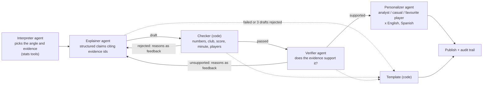

# Pitchside

Turn a live stream of synthetic football events into **explainable match intelligence**: key moments, *why they matter*, and a different experience for an analyst than for a casual fan.

Built for the **Inside the Game: Developer Hackathon**. Everything here is synthetic. All clubs and players are invented, no real match data is used, and no Premier League names or marks appear anywhere.

## Status

| Pipeline stage | Component | Status |
|---|---|---|
| Ingest | Seeded match generator, event schema, live replay | **Done** |
| Interpret | Deterministic stats engine and key-moment detector (no LLM) | **Built (v0.2.0)**: goals found 100%, but some key-moment recall is below our 80% bar on held-out seeds, see [results](#stats-engine-and-how-well-it-works) |
| (model access) | Agent Framework chat clients for Foundry model deployments (Entra ID), offline fake client, token and cost log, budget, concurrency and retry guard | **Built**: tested offline only; not yet run against a live Foundry deployment, see [model client](#model-client-and-cost-controls) |
| Explain | Interpreter, explainer and two-layer verifier (deterministic checker + semantic check) as an Agent Framework workflow, with recaps and an audit trail | **Built (offline-tested)**: runs end to end on the fake model client; **no live model run yet**, so there are no model-quality numbers, see [agents](#agents-explain-verify-personalize) |
| (tools) | The stats engine as a read-only **MCP server** (`pitchside mcp`, stdio and Streamable HTTP) that the interpreter can use | **Built (offline-tested)**; not deployed, see [MCP server](#stats-engine-as-an-mcp-server) |
| Render | Run bundles with overlay timing (`pitchside run`); web UI that replays them | Bundles **built**; UI planned |
| Personalize | Analyst / casual fan / favourite-player views, English and Spanish, one model call per moment | **Built (offline-tested)**; offline translations are tagged placeholders, not real translations |

See [docs/ARCHITECTURE.md](docs/ARCHITECTURE.md) for the target design and [docs/DECISIONS.md](docs/DECISIONS.md)
for the decision log (what we chose, why, and what we rejected).

## Quick start

Uses [uv](https://docs.astral.sh/uv/). `uv sync` creates the virtualenv and installs everything, including dev tools.

```bash
uv sync

uv run pitchside storylines                                  # list scripted storylines
uv run pitchside generate --seed 7 --storyline comeback      # writes matches/<id>.jsonl + .key.json
uv run pitchside summary matches/aur_irv_comeback_0007.jsonl
uv run pitchside replay matches/aur_irv_comeback_0007.jsonl --speed 60   # 90 min in 90 s
uv run pitchside findings matches/aur_irv_comeback_0007.jsonl            # key moments, with their numbers
uv run pitchside eval-stats --seeds 201-220                              # score the stats engine against answer keys
uv run pitchside mcp                                                     # the stats engine as a read-only MCP server (stdio)
uv run pitchside run --seed 7 --storyline comeback                       # stats engine + agents (offline), writes a run bundle
uv run pitchside run --seed 7 --storyline comeback --tools mcp           # same, the interpreter's tools served over MCP
uv run pitchside run --seed 7 --storyline end_to_end --inject-faults demo # same, with deliberate failures to show recovery
uv run pitchside eval-agents --seeds 1-3                                 # score agent runs against answer keys (offline: plumbing check)
uv run pitchside cost --by role                                          # model token usage and cost from the usage log
uv run pitchside schema > docs/event.schema.json             # regenerate the event JSON Schema
uv run pitchside schema --findings > docs/finding.schema.json  # and the findings JSON Schema
uv run pitchside schema --bundle > docs/run_bundle.schema.json # and the run bundle JSON Schema

uv run pytest
```

## What the generator produces

One JSON object per line, validated by pydantic models in [`schema.py`](src/pitchside/schema.py)
([JSON Schema](docs/event.schema.json)):

`match_start` · `period_start` · `pass` · `shot` · `tackle` · `possession_change` · `pressure` · `period_end` · `match_end`

- Coordinates are metres on a 105 × 68 pitch. The clock is match seconds.
- Passes carry distance, ball speed, pressure on the passer and a 0–1 difficulty rating. Shots carry xG and shot speed.
- Possession changes carry the reason and the length of the spell just ended.
- A match is fully determined by `(seed, clubs, storyline)`, so runs are reproducible.

### Storylines and the answer key

A storyline plants real patterns into a match: tactical phases (a pressing surge, a low block, a chaotic spell)
and scripted goals. Each generated match also writes a `.key.json` listing exactly what was planted, so
agent output can be *scored* against ground truth instead of eyeballed.

| Storyline | Planted pattern | Measured effect (mean of 10 seeds) |
|---|---|---|
| `comeback` | Away lead and low block; home press surge from 55'; frantic finish; 0–1 becomes 2–1 | Home shots/min 0.10 → 0.41; pass completion 82% → 72% in the finish |
| `siege` | Home besiege a low block, away score on a counter | Home shots/min 0.09 → 0.45 during the siege |
| `end_to_end` | Open, error-prone game, goals trade | Pass completion 82% → 68%; pressure events 1.7 → 6.7 per minute |
| `balanced` | Control match, natural scoring | ~83% pass completion, ~23 shots, 0–5 goals |

## Stats engine and how well it works

`src/pitchside/stats/` turns events into numbers and typed **findings**, with no LLM involved. `StatsEngine.ingest(event)`
updates rolling (5 min; 8 min for the match-wide chaos numbers) and since-kick-off numbers for possession, field tilt, pressure, pass completion and difficulty,
shots and xG, tempo and a momentum and a control-vs-chaos index, and returns any new findings. A finding
(`goal`, `big_chance`, `momentum_shift`, `pressure_surge`, `siege`, `chaos_spell`, `counter_attack`) always carries the
evidence numbers behind it and their time window ([JSON Schema](docs/finding.schema.json)). Later, agents may only
narrate those numbers and a verifier checks them.

It is scored against the answer keys the generator writes (`pitchside eval-stats`). A planted phase is **detected** if a
matching finding fires from 1 minute before to 8 minutes after the phase starts (counter-attacks: from the phase start
to 1 minute after it ends); a detection 1-2 minutes early is counted as premature, not as a hit. The `low_block`
phases are not scored. The bar for each storyline is 80% recall, and for `balanced` at most 1.0 spell finding per match.
Thresholds were tuned on seeds 1-6 (momentum, pressure surge, siege) and 1-40 (counter-attack and chaos rules). They were
**not** tuned on the seeds below.

| Run | What it is | Comeback | End-to-end | Siege (siege / counter-attack) | Balanced spell findings per match | Goals found |
|---|---|---|---|---|---|---|
| Seeds 101-120 | **First held-out run** (first counter-attack rule, first chaos rule) | 85% | 85% | 65% (100% / 30%) | 0.70 | 100% |
| Seeds 101-120 | Same seeds, after the counter-attack retune, first chaos rule (no longer pristine) | 85% | 85% | **62%** (100% / 25%) | 0.70 | 100% |
| Seeds 201-220 | Fresh seeds, run once after the counter-attack retune, first chaos rule | **78%** | **75%** | **75%** (95% / 55%) | **1.10** | 100% |
| Seeds 101-120 | Re-run after the chaos retune (no longer pristine) | **78%** (chaos 65%) | **70%** (chaos 70%) | **62%** (100% / 25%) | 0.50 | 100% |
| Seeds 201-220 | Re-run after the chaos retune (no longer pristine) | **78%** (chaos 70%) | **75%** (chaos 75%) | **75%** (95% / 55%) | 0.50 | 100% |
| Seeds 301-320 | **Fresh seeds, run once after the chaos retune** | **78%** (chaos 60%) | 80% (chaos 80%) | **65%** (100% / 30%) | 0.45 | 100% |

Bold means below the bar (80% recall, or at most 1.0 spell findings per balanced match). Plainly:

- **The 80% recall bar is met in 1 of the 9 latest held-out checks** (end-to-end on seeds 301-320, at exactly 80%).
  The other eight storyline results are 62-78%.
- **Goals are found exactly**, every time. The balanced spell-finding cap is met on all three ranges (0.45-0.50 per match).
- **Siege and momentum shifts are found reliably** (siege 95-100%, momentum shift 85-95%), typically 3-6 minutes after the
  phase starts, because the windows need time to fill. The median lag is +3 to +6 minutes and the worst +8.
- **Counter-attacks are weak**: 25%, 55% and 30% on the three held-out ranges (about 37% pooled). On a per-event basis the
  planted counters look like ordinary quick transitions, so a rule that finds more of them also fires about 3 times per
  balanced match outside the planted windows. We did not loosen the bar or the matching rules. Counter-attack findings are
  therefore kept as low-severity context (severity 0.1 to 0.3) and never trigger a model call on their own; a counter that
  scores is narrated through its goal finding, which says how the possession began (seconds since the turnover, passes,
  metres gained).
- **Chaos spells** are found 60-80% of the time (comeback 60-70%, end-to-end 70-80%). The chaos retune used an 8-minute
  window to stop chaos firing on balanced play, which worked (balanced spell findings 0.70 and 1.10 down to 0.50 and 0.50),
  but it cost recall: on seeds 101-120 and 201-220 combined, comeback chaos fell from 75% to 68% and end-to-end chaos
  from 80% to 73%, and detection is slower (median +4 to +6 minutes).

The held-out recall tests in [tests/test_stats_heldout.py](tests/test_stats_heldout.py) mark each shortfall above as an
expected failure with its measured numbers; every other bar is a normal assertion. The full reasoning and the options we
did not take are in [docs/DECISIONS.md](docs/DECISIONS.md).

## Agents: explain, verify, personalize

`src/pitchside/agents/` narrates the stats engine's findings with four **Microsoft Agent Framework** agents, each on
its own guarded chat client. Every model-eligible finding (goals, big chances, the start of a siege, surge,
momentum shift or chaotic spell, with severity at least 0.5), plus a **half-time and a full-time recap**, runs
through its own Agent Framework **graph workflow** with typed handoffs:



- **Numbers first.** Every number a model may use has an id in an evidence ledger (finding evidence, stats-tool
  results, player numbers). Claims must cite ids and list each number they use.
- **Two-layer verifier.** A deterministic checker rejects a claim whose number does not match its evidence (to the
  precision written), gives a number to the wrong club, states a score the match never had, puts a minute outside
  the evidence window, or names a player the evidence does not include. Only then does the verifier agent judge
  overclaiming and unsupported causes. Rejection reasons go back to the explainer; at most three drafts.
- **Failure recovery.** Interpreter down: rule-based brief. Explainer down, or every claim rejected: a template
  narrative marked `source: template` with the reason. Verifier down: claims accepted on the deterministic check
  alone, flagged `semantic_check: skipped: <reason>`. Personalizer down, or one of its texts fails the checks:
  template text for those personas. Over budget: later moments go straight to templates, and the run says so.
- **Recaps** at half-time and full-time are built from the claims already verified during the match, plus totals and
  player numbers (scorers, each club's top xG, the featured players), through the same flow.
- **Personalization in one call per moment**: analyst, casual fan and a favourite-player view for one featured player
  per club, in every configured language (`PITCHSIDE_LANGUAGES=en,es`), with numbers kept as digits so the checker
  verifies every language. Adding a language is one phrase table in `languages.py` plus a config entry.
- **Audit trail.** Every step records its prompt version and digest, the claims, each verdict with its reason code,
  the feedback, retries and fallbacks; usage rows link each model call to its job, step and attempt.
- **Run bundles** (`pitchside run`): events, 30-second stats, findings, narratives with overlay timing, audit trail and
  usage as plain JSON ([schema](docs/run_bundle.schema.json)), labelled honestly ("Recorded run generated by the live
  pipeline", or an offline label; injected faults are always announced). Milestone 5 replays them.
- **No coordinator agent.** Routing has one correct answer that code can compute, so a plain-code director does it;
  see [decision 13](docs/DECISIONS.md).

### Offline evaluation: a plumbing check, not model quality

`uv run pitchside eval-agents --seeds 1-3` runs every storyline through the whole pipeline on the **fake model
client** and scores the output against the answer keys. The fake agents are deterministic and correct by
construction (they build claims only from the evidence phrases, and their Spanish is a tagged placeholder), so these
numbers show that the pipeline is wired end to end. **They say nothing about how well a real model writes.** The
interesting offline numbers come from deliberately injected faults:

| Offline run (seeds 1-3, 12 matches) | Result |
|---|---|
| Clean | Planted phases the stats engine detected: 13 of 13 narrated, naming the right club (10 by a model narrative, 3 by a template because their finding fell below the severity floor); goals: 35 of 35 narrated with the scoring club and the score; 24 of 24 recaps; 0 fallbacks |
| `--inject-bad 0.3` (first explainer draft of 30% of jobs corrupted: wrong number, wrong club, no evidence, unknown id, unlisted number, minute outside the window, impossible score) | 42 of 42 corrupted drafts caught; 28% of jobs needed a retry; 0 shown claims fail a fresh re-check |
| `--inject-faults demo` (rate limit, malformed reply, verifier timeout, personalizer outage, claims rejected on every draft, semantic rejection) | every recovery path taken; 5% of model jobs ended in a template, each with its reason |

The live evaluation (`--live`, run manually) reports the same metrics for a real model, plus a `spotcheck.md` of
shown claims for a person to judge. See [docs/LIVE_EVAL.md](docs/LIVE_EVAL.md). **Not run yet.**

**Estimated** cost at GPT-6 Luna prices ($0.10 in / $0.50 out per 1M tokens), to be replaced by measured cost:
about 5 model calls per moment, about $0.0023 per moment, so about $0.015 per balanced match and $0.03-0.04 per
storyline match (12-13 moments plus 2 recaps). Final recorded runs use `PITCHSIDE_MATCH_BUDGET_USD=0.25` so that no
moment is downgraded to a template for budget reasons; the bundle manifest counts budget fallbacks (should be 0).

## Stats engine as an MCP server

`uv run pitchside mcp` serves the deterministic stats engine over the [Model Context Protocol](https://modelcontextprotocol.io)
as twelve **read-only tools** with typed schemas: possession, field tilt, pressure, passing, shots and xG, momentum,
control vs chaos, key moments, evidence lookup, match totals, recent window and a match list. Transports: stdio (local
clients) and Streamable HTTP (`--transport streamable-http`), which is the shape a Container Apps deployment will use.
Full reference, client notes and the deployment plan: [docs/MCP.md](docs/MCP.md).

- **No future leakage.** Every stats tool requires `as_of_s` (match seconds) and computes only from events at or before it,
  enforced server-side in one place. The tests replace everything after the bound with another match's events and require
  identical answers from every tool, over the real protocol, and check that no timestamp in any response is later than
  `as_of_s`; deliberately breaking the bound makes them fail.
- **The interpreter can use it.** `PITCHSIDE_TOOLS=mcp` (default `local`) gives the interpreter the MCP tools through Agent
  Framework's `MCPStreamableHTTPTool`: by default the real server runs in-process behind the real Streamable HTTP
  transport, or `PITCHSIDE_MCP_URL` points at a deployed one. The host sets the time bound on every call, whatever the
  model passes, and every number a tool returns gets an evidence id before the model sees it, so claims that use tool
  numbers are checked like any other. A test runs the same matches in both modes and requires identical ledgers,
  narratives and audit trails.
- **Not deployed.** Container Apps deployment is milestone 6; the exact command and settings are in
  [docs/MCP.md](docs/MCP.md), and the same flags were checked locally over a real socket (HTTP 200 for the allowed host,
  421 for any other). Only Agent Framework's MCP clients and the SDK's in-memory client are tested; other MCP clients
  are untested here.
- **SDK version.** The MCP Python SDK is pinned below 2 (`mcp>=1.24,<2`): the latest Agent Framework (1.22.0) declares
  `mcp<2` and fails against SDK 2.x. See [decision 15](docs/DECISIONS.md).

## Model client and cost controls

`src/pitchside/llm/` gives each agent role (interpreter, explainer, verifier, personalizer) its own chat client,
which the agents above use.

- **Offline by default.** `PITCHSIDE_LLM=fake` (the default) uses a deterministic fake client, so everything runs with
  no Azure account and no cost. Tests can script failures: rate limits, timeouts, connection and server errors,
  auth failures, malformed output.
- **Live mode** (`PITCHSIDE_LLM=foundry`) calls model deployments in a Microsoft Foundry project, authenticated with
  Microsoft Entra ID (`az login` locally, no API keys). Configure it from [.env.example](.env.example).
- **Every call is logged** to `runs/llm_usage.jsonl`: role, match, finding, deployment, model, tokens (input, cached,
  output), cost and latency. `uv run pitchside cost` summarises the log.
- **Spending caps** are checked *before* each call: $0.10 and 200 calls per match, $10 across the log, at most 4 calls
  at once. A refused call is never sent. Prices fail closed, and a timed-out call is charged the worst case.
- **Failures** are retried with backoff where that can help; otherwise the caller gets a typed error and (from
  milestone 3) falls back to a template narrative built from the stats engine's numbers.

Status: tested offline, including the real Agent Framework clients against canned HTTP responses. It has **not yet
been run against a live Foundry deployment**. The manual check for that is
`uv run python scripts/smoke_foundry.py` (after `az login`), which reports the API path that works and the model
the service returns.

## Technology

Current: Python 3.11+, pydantic v2. Agents and model access (built and tested offline, not yet run live):
**Microsoft Agent Framework** (Python: `Agent`, graph workflows with `WorkflowBuilder`, function tools, MCP client tools,
chat and function middleware), the **Model Context Protocol** Python SDK (the stats server), the **Azure AI Projects SDK** for the Microsoft Foundry project endpoint, and **Azure Identity**
(Microsoft Entra ID, `DefaultAzureCredential`). Other Azure components are listed in
[docs/ARCHITECTURE.md](docs/ARCHITECTURE.md) as *planned* and will move here once they are built.

## Development

```bash
uv run pytest                # ~2 min: generator, schema, stats engine, held-out answer-key bars (known recall shortfalls are xfail, see above), model client, agents and MCP server (offline, fake client)
uv run python scripts/smoke_foundry.py   # manual, live, costs a few cents at most: not part of the test suite
uv run pitchside eval-agents --seeds 201-205 --live   # manual live evaluation, see docs/LIVE_EVAL.md
uv add <package>             # add a dependency (updates pyproject.toml and uv.lock)
```

Commit `uv.lock` so everyone, including CI and the judges, gets identical versions.
Tests also run under plain `python -m unittest discover -s tests` with `PYTHONPATH=src`.
