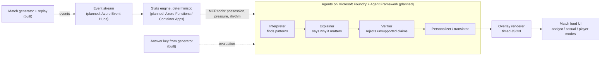

# Architecture

Status key: **built** exists in this repo today; *planned* is the target design.

## Design principles

1. **Numbers first, words second.** The stats engine is plain code. Agents only narrate figures it computed,
   and the verifier agent checks every sentence against those figures before it reaches a screen.
   This is what makes the explanations *explainable* rather than plausible-sounding.
2. **Ground truth for evaluation.** The generator plants known narratives and records them in an answer key.
   Agent output can then be scored (did it find the press surge? did it place the momentum shift in the
   right window?) with Foundry evaluations or a simple script.
3. **One event contract.** Every stage consumes the same pydantic-validated events
   ([schema.py](../src/pitchside/schema.py)), published as [JSON Schema](event.schema.json).
4. **Deterministic replays.** `(seed, clubs, storyline)` fully determines a match, so demos, tests and
   evaluations are repeatable.

## Planned agent roles

| Agent | Responsibility | Handoff |
|---|---|---|
| Interpreter | Detect momentum shifts, siege / counter-attack spells, chaos vs control from stats windows | Structured findings with evidence |
| Explainer | Turn a finding into a short narrative that says *why* it matters | Draft narrative plus the numbers it relies on |
| Verifier | Check each claim against the stats engine; send back anything unsupported | Approved narrative, or a retry with feedback |
| Personalizer | Re-voice for analyst, casual fan or favourite-player mode; translate | Per-audience text |
| Renderer | Emit timed, machine-readable overlay JSON | Overlay messages |

## Open decisions

- Event transport for the demo (Event Hubs vs a lighter queue) versus the cost of keeping it running until the end of judging.
- Which Azure services to host the always-on demo on, with a free-to-test link for judges.
- Overlay schema details, since the challenge gives no format.
