# Architecture

Status key: **built** exists in this repo today; *planned* is the target design.

```mermaid
flowchart LR
    G["Match generator + replay<br/>(built)"] -->|"events (in process)"| S["Stats engine + key-moment detector, deterministic<br/>(built)"]
    S -->|"findings + stats tools<br/>(function tools and MCP server built; MCP on Container Apps: template ready, not deployed)"| A
    subgraph A["Agents: Agent Framework workflow per moment (built, tested offline; live run pending)"]
        I["Interpreter<br/>picks angle + evidence"] --> E["Explainer<br/>structured claims"]
        E --> C["Checker (code)"]
        C --> V["Verifier<br/>rejects unsupported claims"]
        V --> P["Personalizer / translator"]
        C -. feedback .-> E
        V -. feedback .-> E
    end
    P --> R["Run bundle + overlay contract<br/>(built)"]
    R --> UI["Web UI: broadcast view, analyst dashboard, evidence drawer<br/>(built; Static Web Apps: template ready, not deployed)"]
    K["Answer key from generator<br/>(built)"] -.->|"evaluation (built)"| A
```

## Design principles

1. **Numbers first, words second.** The stats engine is plain code. Agents only narrate figures it computed,
   and the verifier agent checks every sentence against those figures before it reaches a screen.
   This is what makes the explanations *explainable* rather than plausible-sounding.
2. **Ground truth for evaluation.** The generator plants known narratives and records them in an answer key.
   Agent output can then be scored (did it find the press surge? did it place the momentum shift in the
   right window?) with Foundry evaluations or a simple script.
3. **One event contract.** Every stage consumes the same pydantic-validated events
   ([schema.py](../src/pitchside/schema.py)), published as [JSON Schema](event.schema.json).
4. **Deterministic replays.** `(seed, clubs, storyline)` fully determines a match, so demos, tests and
   evaluations are repeatable.

## Agent roles (built; tested offline, live run pending)

The stats engine detects the moments; the agents explain them. One Agent Framework graph workflow per moment
(and per half-time / full-time recap), started by a plain-code director. Details: [DECISIONS.md](DECISIONS.md)
entries 12-14 and the README's agents section.

| Step | Responsibility | Handoff |
|---|---|---|
| Interpreter (agent) | Pick the angle and the evidence that matters; may call stats tools, whose numbers get evidence ids | Brief: angle, focus evidence ids, note |
| Explainer (agent) | Write 1-3 claims, each citing evidence ids and listing its numbers | Draft of structured claims |
| Checker (code) | Numbers match evidence, right club, valid score, minute in window, cited players | Pass, or reasons back to the explainer |
| Verifier (agent) | Does the evidence support what each claim says (no overclaiming, no invented causes)? | Pass, or reasons back to the explainer (at most 3 drafts) |
| Personalizer (agent) | Analyst, casual fan and favourite-player texts in every language, in one call; texts re-checked | Persona x language texts |
| Fallback (code) | Template narrative from the same evidence when a step cannot recover | Narrative marked `source: template` with the reason |
| Renderer | Overlay contract (`overlay.json`) and the static web UI that replays run bundles (built) | Bundle files |

## Model client (built; tested offline, first live run pending)

Every agent role gets a Microsoft Agent Framework chat client (`src/pitchside/llm/`). Live: `OpenAIChatClient`
(Responses API, or Chat Completions via `FOUNDRY_API`) on the `AsyncOpenAI` client that the Azure AI Projects SDK
builds for the Foundry project endpoint, authenticated with Microsoft Entra ID. Offline (the default):
`FakeChatClient`, deterministic and scriptable. Every role uses the same small model: gpt-5-mini for now (our trial
subscription has no GPT-6 Luna quota), Luna if quota is granted ([DECISIONS.md](DECISIONS.md) entry 19); each role
reads its deployment name from configuration. Each client carries one `ModelGuard` middleware, so every model
round-trip, including tool-call loops, goes through the same steps:

1. reserve the worst-case cost against the per-match, per-match-call and total caps (refuse without sending);
2. wait for one of a shared number of call slots (default 4);
3. call with a deadline;
4. log tokens, cost and latency to the JSONL usage log, tagged with role, match and finding; settle the budget;
5. on rate limit, timeout, connection or 5xx: back off (full jitter, honouring `retry-after`) and retry; otherwise
   raise an `LLMError`, which agents turn into a deterministic template narrative.

Why: [DECISIONS.md](DECISIONS.md) entries 10 and 11.

## Hosting (template written and validated offline; not deployed yet)

One resource group from one Bicep template ([docs/AZURE.md](AZURE.md), [DECISIONS.md](DECISIONS.md) entry 18): Azure
Static Web Apps (Free) serves the UI and the recorded runs to judges; Azure Container Apps hosts the read-only MCP
server (IP allow-list, in-app rate limit, scale to zero) that the live recordings use; Log Analytics keeps its logs;
a budget sends alerts. No event broker: matches are replayed in process and the public demo is static, so Event Hubs
or Event Grid would cost money without a consumer. The overlay format is settled in [OVERLAY.md](OVERLAY.md).
